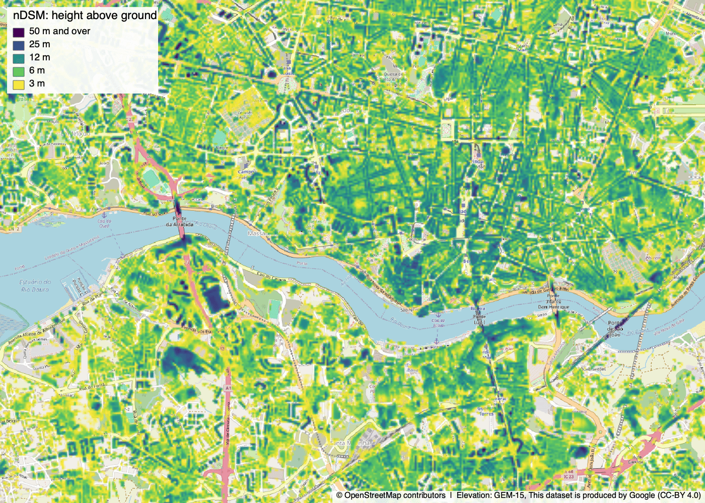
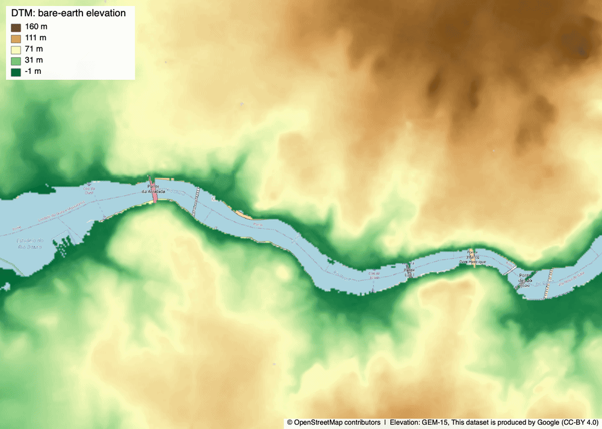

# GEM-15 Elevation Downloader (QGIS plugin)

> **Unofficial.** This plugin is not made, endorsed or supported by Google. It reads the files Google publishes. Report problems with the plugin [here](https://github.com/ColdLabs/qgis-gem15-elevation/issues), not to Google.

Downloads [GEM-15](https://developers.google.com/earth-engine/datasets/catalog/projects_climate-and-sustainability_assets_gem-15_v1), the near-global 15 m elevation model from Google Research, for the map view or the polygons of a layer. You get up to three GeoTIFFs:

- **DTM**: bare-earth elevation.
- **DSM**: surface elevation, including buildings, trees and bridges.
- **nDSM**: DSM minus DTM, the height of what stands on the ground.

Heights are in metres, relative to the EGM96 geoid. Google made GEM-15 from sub-metre optical stereo imagery acquired up to 2024, and labels it experimental.



*Porto and Vila Nova de Gaia, Portugal: the nDSM from the plugin, as QGIS loads it, over OpenStreetMap. About 6 by 4 km.*



*The same area as DTM, DSM and nDSM. Ground elevation runs from the Douro river to about 160 m; the DSM adds the city on top. [MP4 version](docs/porto-dtm-dsm-ndsm.mp4).*

Coverage is 60° S to 84° N, except Russia, China, Mongolia, Greenland and Antarctica. Google offsets the data over India on purpose, to comply with Indian geospatial rules. The DTM is less accurate under dense forest, and Google advises checking absolute heights against local survey points where they matter.

A 15 m pixel is the mean of the finer surface inside it, so features narrower than a pixel come out lower and wider than they are. Treat the nDSM as a map of where tall things are, not as a measure of one building.

Loaded layers are coloured by elevation (DTM, DSM), green for low and brown for high, from the lowest to the highest value in the area. The nDSM is coloured by height: see-through under 2 m, so streets and open ground show the map below, then 3, 6, 12, 25 and 50 m and over, light to dark.

## Install

In QGIS: **Plugins → Manage and Install Plugins → All**, search for "GEM-15 Elevation Downloader", then **Install**. Requires QGIS 3.38 or later (Qt5 or Qt6). No extra Python packages are needed.

To install without the plugin repository, download the zip from the [latest release](https://github.com/ColdLabs/qgis-gem15-elevation/releases/latest) and use **Plugins → Manage and Install Plugins → Install from ZIP**.

## Use

- Toolbar button (Web toolbar) or **Web → GEM-15 Elevation**: opens the dialog with the current map extent filled in. If the active layer is a polygon layer with selected features, those become the area.
- **Processing Toolbox → GEM-15 Elevation → Download elevation**: same algorithm; works in models and batch mode.
- Command line:

```
qgis_process run gem15elevation:download -- EXTENT="-8.62,-8.58,41.13,41.16 [EPSG:4326]" PRODUCTS=0 PRODUCTS=2 OUTPUT_DTM=dtm.tif OUTPUT_NDSM=ndsm.tif
```

`PRODUCTS`: 0 DTM, 1 DSM, 2 nDSM; repeat it for more than one. With polygons, pixels outside them are left empty.

Output is a GeoTIFF, in the UTM zone Google uses for the cell at the area centre, unless you set **Output CRS** (`CRS`). That is usually the standard zone; in western Norway, for example, Google uses zone 32. In that zone the pixels are Google's own, unchanged. In any other CRS they are reprojected with bilinear resampling. An area that crosses a UTM zone line is reprojected on the side that is not in the output zone.

The output covers the bounding box of the area, so the run stops before downloading if that box is larger than "Stop if the bounding box of the area exceeds (km²)" (2500 km² by default). Two polygons far apart, or an area across the 180° meridian, have a very large box; the 180° case is not supported. At 15 m, 2500 km² is about 11 million pixels, or 45 MB uncompressed, per product.

Every output file carries the attribution in its metadata (`ATTRIBUTION`, `LICENSE`, `SOURCE`), so the credit stays with the data. Files written by `qgis_process` carry no style.

## How it fetches data

Google publishes one Cloud-Optimized GeoTIFF per product and 1° cell, in that cell's UTM zone, on a 15 m grid, with a [STAC catalogue](https://storage.googleapis.com/climate-and-sustainability/gem-15/stac/catalog.json) next to them. The bucket is public: no account or key. The plugin:

1. works out which 1° cells touch the area (`cells.py`). Cells are named after their south-west corner: `wm9s41` is longitude −9 to −8, latitude 41 to 42.
2. reads each cell's STAC item for the file URLs. A cell with no item has no data, such as open sea.
3. lets GDAL read only the blocks of each file that cover the area, through HTTP range requests, and writes them into one raster per product.
4. computes the nDSM from the DSM and DTM on the same grid.

The DSM file of the Porto cell is 785 MB, but a clip reads only the blocks it needs: 11 km² of central Porto takes about 2 seconds per product. Nothing is cached, so the same area downloads again on the next run.

STAC items come through the QGIS network manager, so the proxy and SSL settings in QGIS apply to them. The rasters are read by GDAL; if your network needs a proxy, set `GDAL_HTTP_PROXY` as well.

The DSM file also holds the 5th, 50th and 95th percentiles and the standard deviation of the native surface in each pixel. The plugin downloads only the main DSM band.

## Data licence

GEM-15 is published by Google under [CC BY 4.0](https://creativecommons.org/licenses/by/4.0/), which requires the attribution "This dataset is produced by Google". Keep it when you publish maps or data made with it. See the [dataset page](https://developers.google.com/earth-engine/datasets/catalog/projects_climate-and-sustainability_assets_gem-15_v1) and the [preprint](https://eartharxiv.org/repository/view/16034/) (doi:10.31223/X55N75). This plugin is not affiliated with Google.

## Development

Link the plugin folder into your QGIS profile instead of installing the zip (macOS, QGIS 4):

```
ln -s "$PWD/gem15_elevation_downloader" ~/Library/Application\ Support/QGIS/QGIS4/profiles/default/python/plugins/
```

`uvx pytest` runs the tests of the part that needs no QGIS (`cells.py`), including cell names checked against Google's bucket.
`./build_zip.sh` writes `dist/gem15_elevation_downloader-<version>.zip` for upload to plugins.qgis.org.
`./check.sh` runs the scanners the plugin site runs: Bandit and detect-secrets block an upload, flake8 is advisory.

## Licence

GPL-2.0-or-later. See [LICENSE](LICENSE).
